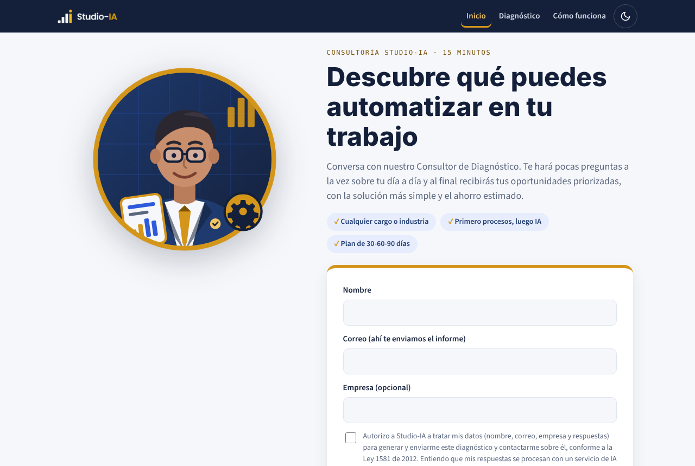
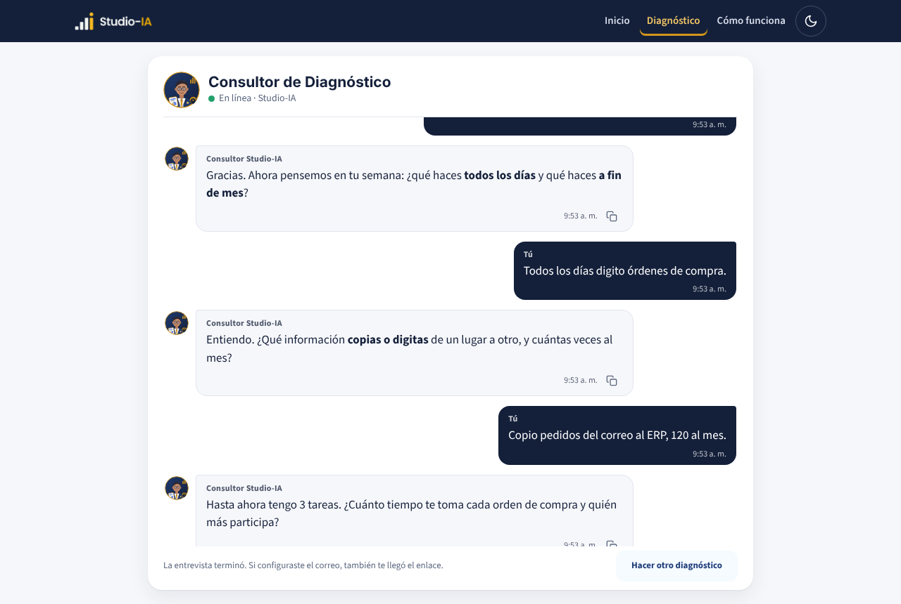
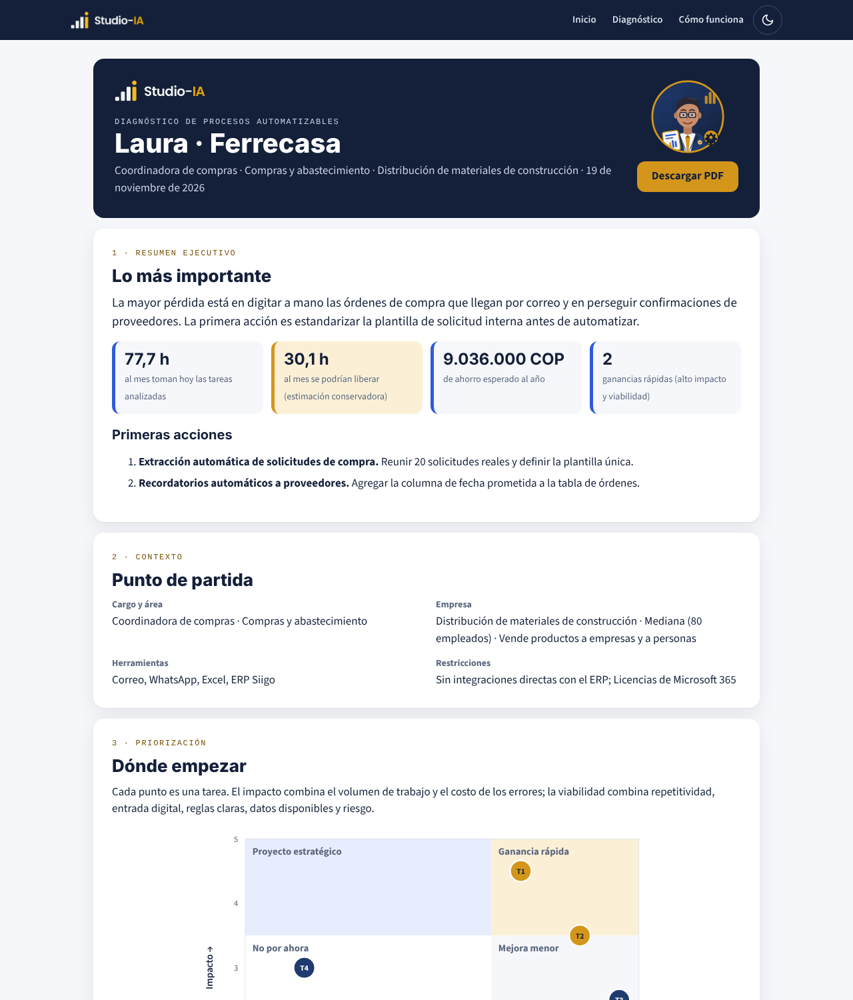

# Diagnóstico de automatización · Studio-IA

Chat web en el que el **Consultor de Diagnóstico de Studio-IA** entrevista a cualquier persona (cualquier cargo, empresa o industria) y al final le entrega un **diagnóstico priorizado**. El diagnóstico trae el inventario de tareas, la matriz de impacto y viabilidad, de 3 a 5 fichas de oportunidad con el filtro de decisión, el ahorro estimado y una hoja de ruta de 30-60-90 días.

Construido sobre la base técnica de **SpiderChat** (Proyecto Integrador M3, Henry):

- SPA con HTML, CSS y JavaScript sin frameworks;
- funciones serverless de Vercel;
- Google Gemini, con la key solo en el servidor.

El método del consultor viene de la skill `diagnostico-automatizacion-ia` v2.

| Inicio | Chat | Informe |
| :-: | :-: | :-: |
|  |  |  |

Las capturas son del **modo simulado**, con datos ficticios.

---

## Cómo funciona

```
Registro con consentimiento ──► POST /api/sesion ──► saludo del consultor (Gemini)
                                         │
Entrevista (1-3 preguntas por turno) ──► POST /api/chat ──► Gemini con PROMPT_ENTREVISTA
                                         │    el historial vive en el servidor (PostgreSQL)
            ┌────────────────────────────┘
            ▼  cierre: el consultor escribe [[DIAGNOSTICO]], la persona pulsa
               "entrégame el diagnóstico" o se llega al límite de turnos
Análisis ──► Gemini con PROMPT_ANALISIS y salida JSON con esquema
         ──► validación con Zod (+ coherencia) y hasta 3 correcciones automáticas
         ──► cálculos en código: horas, impacto, viabilidad, cuadrante y ahorro
         ──► se guarda en PostgreSQL + correo con el enlace (SMTP, opcional)
Informe ──► /diagnostico/:id ──► GET /api/diagnostico ──► vista imprimible a PDF
```

**Decisiones clave**

- **Dos prompts.** Uno para conversar (corto, cálido, de 1 a 3 preguntas por turno) y otro para analizar (reglas del filtro de decisión y de la calificación). Cada uno hace mejor su trabajo por separado.
- **El modelo no hace las cuentas.** Gemini entrega minutos, frecuencias y notas de 1 a 5; las horas, los cuadrantes y el dinero se calculan en `lib/calculos.js`, así las cifras siempre cuadran.
- **El historial vive en el servidor.** El navegador solo envía el mensaje nuevo, así que nadie puede inventar respuestas del consultor ni gastar la key para otros fines.
- **Salida JSON con respaldo.** Primero se pide JSON con esquema (`responseFormat`). Si la API rechaza ese formato (400), se prueba `responseJsonSchema` y, por último, JSON sin esquema, describiendo el esquema en el prompt. Siempre se valida con Zod.
- **Seguridad heredada de SpiderChat:**
  - la key va en el header `x-goog-api-key`, nunca en la URL;
  - todo se pinta con `textContent` (sin `innerHTML` con datos);
  - los errores llegan genéricos al usuario y el detalle queda solo en los logs.
- **Privacidad:**
  - consentimiento explícito (Ley 1581 de 2012);
  - el consultor pide no compartir datos confidenciales;
  - el informe no expone el correo;
  - las páginas del informe llevan `noindex`.

---

## Estructura

```
├── api/                      # Funciones serverless de Vercel
│   ├── sesion.js             # POST registro + saludo · GET recuperar conversación
│   ├── chat.js               # POST mensaje (y cierre → diagnóstico)
│   └── diagnostico.js        # GET datos del informe
├── lib/                      # Lógica del servidor (no se publica)
│   ├── prompts.js            # Instrucciones de entrevista y de análisis
│   ├── gemini.js             # Llamadas a Gemini, JSON con esquema, modo simulado
│   ├── esquema.js            # Esquema Zod del diagnóstico + versión para Gemini
│   ├── calculos.js           # Horas, impacto, viabilidad, cuadrante, ahorro
│   ├── servicio.js           # Flujo: iniciar, conversar, cerrar, informe
│   ├── store.js              # PostgreSQL (o memoria en local)
│   ├── correo.js             # Correos por SMTP con nodemailer (opcional)
│   ├── http.js               # Errores uniformes (429, 502, 500)
│   └── ejemplo.js            # Diagnóstico ficticio (modo simulado y tests)
├── src/                      # Frontend publicado
│   ├── index.html · styles.css · app.js (routing) · chat.js · informe.js
│   ├── dom.js (creación segura de elementos) · utils.js (funciones puras) · theme.js
│   └── assets/ avatar-consultor.svg · logo-claro.png · logo-oscuro.png
├── database/schema.sql       # Tablas sesiones, mensajes, diagnosticos y vista_leads
├── scripts/dev-server.js     # Servidor local sin la CLI de Vercel
├── tests/                    # Vitest: 27 pruebas, sin llamar a Gemini de verdad
└── vercel.json
```

---

## Ejecutar en local

```bash
npm install
npm run dev:simulado   # sin key: guion simulado, ideal para probar la interfaz
```

Abre http://localhost:3000.

Para usar Gemini de verdad:

1. Copia `.env.example` como `.env`.
2. Pon tu `GEMINI_API_KEY`.
3. Ejecuta `npm run dev`.

Con PostgreSQL local:

```bash
createdb -U postgres diagnostico_ia
psql -U postgres -d diagnostico_ia -f database/schema.sql
```

Luego pon `DATABASE_URL` en `.env`. Sin `DATABASE_URL`, en local los datos se guardan en memoria y se pierden al reiniciar. `vercel dev` también funciona.

### Retomar la conversación

Al registrarse, si el SMTP está configurado, la persona recibe un correo con un enlace personal `/retomar/<id>`. Al abrirlo, el navegador guarda esa sesión y continúa el chat donde quedó, también desde otro dispositivo. Sin SMTP, la sesión solo se retoma en el mismo navegador.

## Tests

```bash
npm test
```

27 pruebas en 4 archivos:

- `utils.test.js`: funciones puras del navegador; el texto de consentimiento es igual en el navegador y en el servidor; el HTML no se interpreta.
- `calculos.test.js`:
  - horas, dinero, cuadrantes, orden de oportunidades y coherencia;
  - el esquema para Gemini no trae palabras clave no soportadas.
- `gemini.test.js`, con `fetch` simulado:
  - la key va en el header;
  - se propaga el 429;
  - se cambia de formato ante un 400;
  - se pide corrección si el JSON no cumple el esquema.
- `api.test.js`:
  - recorrido completo registro → entrevista → diagnóstico → informe;
  - errores 400, 405, 409 y 404;
  - el informe no expone el correo.

## Desplegar en Vercel

1. **Neon (PostgreSQL):**
   - crea un proyecto en [neon.tech](https://neon.com) (o instala Neon desde Vercel → Marketplace, que define `DATABASE_URL` por ti);
   - copia la cadena de conexión **pooled** (host con `-pooler`, termina en `?sslmode=require`);
   - ejecuta `database/schema.sql` en el SQL Editor de Neon, o con `psql "<cadena>" -f database/schema.sql`.
2. **Vercel:** sube el repo a GitHub e impórtalo (Framework Preset: **Other**).
3. **Variables de entorno:**
   - obligatorias: `GEMINI_API_KEY`, `DATABASE_URL` (la de Neon) y `APP_URL` (el dominio de Vercel, sin `/` final);
   - opcionales: las de SMTP (`SMTP_HOST`, `SMTP_PORT`, `SMTP_USER`, `SMTP_PASS`, `CORREO_REMITENTE`).
4. **Deploy.** El turno que genera el diagnóstico puede tardar 1-2 minutos: `vercel.json` le da 120 s a `api/chat.js`. Revisa que tu plan lo permita.

Los contactos y diagnósticos se ven con `select * from vista_leads;`.

## Antes de abrirlo al público

- **Cuota gratuita de Gemini.** Tiene límites por minuto y por día: con varias personas a la vez aparecerán errores 429.
- **Uso de datos.** Según los términos de Gemini, Google puede usar los datos del nivel gratuito para mejorar sus productos, y revisores humanos pueden leerlos. Google pide no enviar información sensible o confidencial a ese nivel. Para clientes reales, activa la facturación (nivel de pago) o mantén el aviso del consentimiento.
- **Calidad del análisis.** `gemini-3.5-flash-lite` es rápido y barato. Si las fichas salen pobres, cambia `GEMINI_MODEL_ANALISIS` por un modelo más capaz: solo se usa una vez por diagnóstico.
- **Límites.** Hay un tope de 40 mensajes por sesión y de 3.000 caracteres por mensaje. No hay límite por IP: si lo publicas abiertamente, agrégalo (por ejemplo, con Vercel Firewall).
